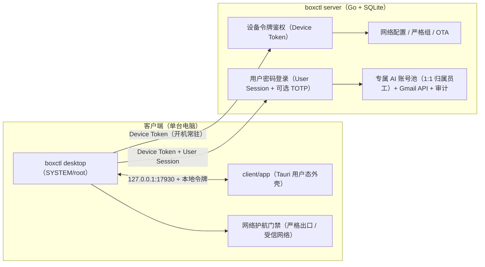
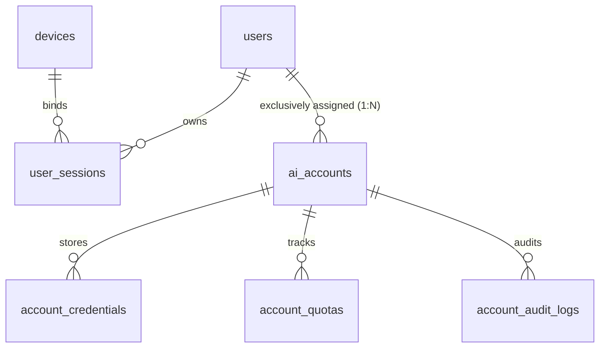

# Banbu Connect 转型「企业级 AI 账号与多工作区管理器」可行性研究报告

> **范围与目标**：将 `Banbu Connect`（Client）与 `boxctl server`（管理服务端）升级为企业级 AI 账号与多工作区管理平台，面向 **Claude（Desktop APP / Web）、Claude Code CLI、Codex（CLI / Desktop APP）、Antigravity APP、Antigravity CLI（`agy`）** 五类受管终端，提供**按企业登录用户下发专属账号、多工作区隔离与一键切换、应用多开（Multi-Instance）、合规网络出口强制护航与用量审计**能力。

---

## 一、执行摘要与总体结论

**总体结论：技术与架构上高度可行。项目现有的「双进程权限隔离 + 严格出口/Kill Switch 护航 + 加密配置分发 + Gmail API 自动化验证 + OTel 用量遥测」底座，非常适合演进为企业级 AI 账号与工作区管理工具。**

### 核心设计原则（已锁定）

1. **严格遵循单人独占与厂商合规边界**：系统按**“单人独占绑定、多工作区隔离”**建模——每个受管 AI 账号在任意时刻仅归属**唯一一名员工**（用于隔离该员工负责的不同项目、组织、客户工作区或独立工作负载），**架构层面禁止多人共享同一订阅账号，也不搭建消费级订阅的 OAuth 反向代理/中继网关**，从根源上符合 Anthropic、OpenAI、Google 的用户协议与安全规范，同时彻底消除跨人/跨机的单次 Refresh Token 刷新冲突。
2. **许可证合规**：开源项目 `jlcodes99/cockpit-tools` 采用 **CC BY-NC-SA 4.0**（禁止商用且具相同方式共享传染性）。本方案**仅作公开机制与避坑参考，全部功能基于现有 Go + Tauri/Rust 架构净室独立实现**，不复制任何代码，也不内嵌 `cockpit-cli`。
3. **身份体系平滑升级**：首期在 `boxctl server` 内置**企业用户「账号 + 密码（可选 TOTP）」**登录，并与现有**设备令牌（`devices`）**构成双凭据校验（设备令牌管网络护航与 OTA，用户会话管专属 AI 账号下发），后续预留 OIDC 扩展点。
4. **强制网络护航门禁**：所有受管 AI 账号的登录、切换、多开启动均**强耦合 Banbu Connect 的网络合规状态**——必须处于「严格代理组 + Kill Switch 生效」或「已通过出口校验的受信网络（路由盒）」才放行，出口异常或保护失效时自动阻断，防止直连泄漏与出口 IP 漂移。
5. **聚焦核心研发工具链**：本阶段聚焦 **Claude（Desktop/Web + Claude Code CLI）、Codex（CLI/Desktop）、Antigravity（APP + `agy` CLI）**，**不包含 ChatGPT（Web / 原生 Desktop APP）**，从而集中精力把研发主力工具的隔离、多开、切号与审计做到稳定可靠。

### 五大受管终端可行性总览

| 平台与终端 | 总体可行性 | 接入与认证方式 | 一键切号 | 应用多开（并行运行） | 用量 / 额度观测 | 关键约束与注意事项 |
|---|---|---|---|---|---|---|
| **Claude Code CLI** | **极高** | 官方 `claude auth login` + 服务端 Gmail API 辅助取 `magic-link` + 官方 `CLAUDE_CONFIG_DIR` 隔离 | **原生支持**（切工作区目录或本机槽位） | **极高**（官方 `CLAUDE_CONFIG_DIR` 原生多开，macOS 自动按路径哈希隔离 Keychain） | **官方 OTel**（已实现历史 Token/费用审计）+ 本机登录态/状态核对 | 全程走官方 CLI 完成 PKCE/存储，不跨机复制 RT，严禁多进程共享同一未隔离目录 |
| **Claude Desktop APP / Web** | **高** | Electron 独立 `--user-data-dir`（Desktop）/ 固定浏览器档案（Web）+ 服务端 Gmail API 自动取 `magic-link` | **支持**（按工作区档案切换/拉起） | **高**（macOS `open -n --args --user-data-dir` / Windows `--user-data-dir`，注意避开 MSIX 版） | 依赖工作区状态展示（避免无头抓包触发 Cloudflare） | Electron `safeStorage` 绑定本机密钥，档案仅本机持久保留；严禁双进程共用同一 `--user-data-dir` |
| **Codex（CLI / Desktop）** | **高** | `codex login`（Device Code 优先 / `127.0.0.1:1455`）+ Gmail API 辅助取 OTP + `CODEX_HOME` 隔离 | **支持**（切 `CODEX_HOME` 或 `auth.json`+Keychain 双写并重启 `app-server`） | **CLI 极高 / Desktop 中高**（`CODEX_HOME` + `--user-data-dir`；Windows Store MSIX 版需规避或特殊激活） | **支持**（`chatgpt.com/backend-api/wham/usage` 5h/7d 窗口） | Windows 1455 端口常被系统保留区占用；单次 RT 轮换不可跨机共享；`auth.json` 字段需避开 `personal_access_token` 坑 |
| **Antigravity APP** | **高** | 固定浏览器档案完成 Google OAuth → 加密托管 RT（按个人设备同步）→ 写入系统凭据与回退文件 | **支持**（停应用与 hub 进程 → 写凭据 → 重启） | **低**（v2.6+ / 2.0 独立版已将凭据收敛至全局共享 Keychain 与 `~/.gemini/`，强行多开会互相覆盖） | **支持**（`cloudcode-pa` `fetchAvailableModels` 按模型剩余与重置时间） | 需先完成 [Antigravity实测.md](./Antigravity实测.md) `BXC-F0-016` 真机验证新版路径与 RT 行为 |
| **Antigravity CLI（`agy`）** | **高** | 与 Antigravity APP 共用账号配置，同步写入 `~/.gemini/antigravity-cli/antigravity-oauth-token` | **支持**（与 APP 联动同步切换） | **低～中**（待 Phase 0 实测自定义环境变量/目录隔离是否生效，默认定位为单开秒切） | 与 APP 共用按模型配额 | 必须与 APP 同步更新，避免 APP 切换后 `agy` 仍持有旧会话报 429 |

---

## 二、战略转型与现有架构的契合度

### 2.1 现有双进程架构是天然优势

Banbu Connect 现有架构（见 [client/README.md](../client/README.md)）已经把“系统级网络权限”和“用户级桌面会话权限”彻底解耦：

- **`boxctl desktop`（Go，SYSTEM / root 系统服务）**：托管 Mihomo 内核、严格代理组出口探测、Kill Switch（NRPT/防火墙/pf）、受信网络识别、OTLP 本地接收器与管理服务同步，仅在 `127.0.0.1:17930` 提供带 Bearer Token 的本地 API。
- **`client/app`（Tauri v2 Rust，当前登录用户会话）**：负责托盘、窗口、通知、OTA，以及**必须在用户态执行的账号与配置操作**——目前已落地 [claude_login.rs](../client/app/src-tauri/src/claude_login.rs)（调用 `claude auth login` + 轮询 `magic-link` + 核对 `claude auth status`）和 [claude_otel.rs](../client/app/src-tauri/src/claude_otel.rs)（安全增量写入 `~/.claude/settings.json` 并保留备份）。

这套权限分工在转型为企业级账号与多工作区管理器时**无需推倒重来**：
- OS Keychain、用户目录（`~/.claude*`、`~/.codex*`、`~/.gemini*`）、Electron `--user-data-dir` 进程拉起、隔离终端拉起**天然归属 Tauri 用户态外壳**；
- 网络护航门禁、严格代理出口校验、与 `boxctl server` 的加密通信及审计上报**天然归属 `boxctl desktop` 系统服务**。

---

## 三、服务端改造方案：账号密码登录 + 设备双凭据 + 独占账号分配

### 3.1 从“纯设备绑定”扩展为“设备令牌 + 企业用户会话”双凭据

当前 `boxctl server` 仅有机器级 `devices.token_hash` 与审批表 `enrollments`（见 [0003_distribution.sql](../boxctl/internal/store/migrations/0003_distribution.sql)、[0008_enrollments.sql](../boxctl/internal/store/migrations/0008_enrollments.sql)），[0004_claude_accounts.sql](../boxctl/internal/store/migrations/0004_claude_accounts.sql) 将账号直接关联到 `device_id`。

改造方案为**保留设备令牌，叠加企业用户登录**：



- **设备令牌（沿用现有审批流）**：负责机器级的网络代理、Kill Switch 策略、OTA 更新与基础健康诊断，确保电脑开机即处于安全网络底座下。
- **企业用户登录（首期内置账号密码）**：
  - 管理员在 `boxctl server` 创建员工账号（`username` / `email` + 初始密码，首次登录强制改密，支持可选 TOTP MFA 与禁用/离职冻结）。
  - 员工在 Banbu Connect 客户端登录企业账号后，服务端签发**与当前 `device_id` 绑定的用户会话令牌**（服务端仅存哈希，可随时单会话或按用户全量吊销；客户端保存在当前 OS 用户独占目录/Keychain 中）。
  - 所有 AI 账号清单拉取、Gmail 登录辅助、凭据同步、审计上报接口均**双重校验 Device Token + User Session**。
  - 员工使用多台本人设备（如公司 MacBook + 办公 Windows）登录同一企业账号时，自动同步其本人名下分配的 AI 工作区清单；员工离职被管理员禁用时，全部设备的会话立刻失效，并触发本机托管工作区凭据清理。

### 3.2 数据模型增量设计（单人独占硬约束）

通过追加迁移文件（`0009_enterprise_accounts.sql`）实现，平滑兼容现有 `claude_accounts`：



关键表与约束设计：
- `users`：`id`, `username` (`UNIQUE`), `email` (`UNIQUE`), `display_name`, `password_hash`（Argon2id/bcrypt）, `totp_secret`（加密，可选）, `role` (`admin`/`member`), `disabled`, `created_at`。
- `user_sessions`：`id`, `user_id`, `device_id`, `token_hash` (`UNIQUE`), `expires_at`, `revoked`, `last_seen`。
- `ai_accounts`（统一替代 `claude_accounts`）：
  - `provider`：`claude` | `codex` | `antigravity`
  - `surfaces`：允许终端，如 `["desktop","cli"]`
  - `owner_user_id`（`INTEGER REFERENCES users(id)`）：**单人独占归属外键**——每个受管 AI 账号在任意时刻只能归属一名员工（`NULL` 表示未分配待领用），**数据库与接口层直接杜绝多人共享同一账号**。
  - `workspace_label`：工作区标识（如「项目 A / 组织 X / 主力工作区」），用于客户端多开窗口标题与隔离目录命名。
  - `email`、`note`、`status`（`active`/`paused`/`invalid`/`disabled`）
  - `gmail_token`（`secret.Box` 加密，仅含 `gmail.readonly` 只读授权，用于自动化提取所属邮箱的登录验证邮件）
  - `required_egress_group`：强绑定严格代理组名称（如 `Claude`、`ChatGPT`、`Antigravity`），用于客户端门禁校验。
- `account_credentials`：仅用于支持安全跨机同步的平台（如实测确认后的 Antigravity 个人多设备场景），采用 `secret.Box` 加密 + 版本号校验；Claude 与 Codex 默认**不在服务端落盘存储 OAuth 凭据**，凭据仅存于员工本机对应隔离工作区。
- `account_quotas` & `account_audit_logs`：记录各账号配额快照与全部登录/切号/多开/邮件提取审计记录（操作人、设备、时间、出口 IP、结果）。

---

## 四、核心专题调研：应用多开（Multi-Instance）与多工作区隔离

当一名工程师同时持有多个专属账号/工作区（例如不同客户组织、不同项目计费域、或独立并行任务上下文）时，**仅支持“单开切号”会导致中断当前对话或频繁重启应用**；而**应用多开（并行运行多个完全隔离的实例）**则能真正发挥“1 人多工作区”的效率价值。

### 4.1 多开底层机制与风险对比

| 目标应用 | 官方/底层隔离原语 | 凭据隔离效果 | 并行多开可行性 | 平台特殊坑点（macOS / Windows） |
|---|---|---|---|---|
| **Claude Code CLI** | 环境变量 `CLAUDE_CONFIG_DIR`（官方原生支持） | **完全隔离**：macOS 自动以路径哈希区分 Keychain 条目；Windows/Linux 独立存为 `<DIR>\.credentials.json` | **极高（原生无痛）** | 无进程单例锁；可同时开启 N 个终端并行工作，且 OTel `settings.json` 也可分别写入各自 `<DIR>/settings.json` |
| **Claude Desktop APP** | Electron 命令行参数 `--user-data-dir=<DIR>` | **完全隔离**：各自拥有独立的 Cookies、LocalStorage、MCP 配置与 `safeStorage` 加密缓存 | **高** | ① macOS 需用 `open -n -a "/Applications/Claude.app" --args --user-data-dir="..."` 强制新实例，首次启动新档案会弹一次 Keychain 授权；② Windows 应使用官方独立安装包，避免 Microsoft Store（MSIX）沙箱导致参数失效或 `os error 5`；③ 严禁同一目录被启动两次（防 LevelDB 损坏） |
| **Codex CLI** | 环境变量 `CODEX_HOME`（官方原生支持） | **完全隔离**：各自独立 `auth.json`、`config.toml` 与 SQLite 会话/WAL 日志 | **极高（原生无痛）** | 彻底消除多终端共用 `~/.codex` 时的 SQLite WAL 锁争用与单次 RT 并发刷新冲突；建议在各隔离 `config.toml` 中明确 `cli_auth_credentials_store = "file"` 防止共用默认 Keychain 键 |
| **Codex Desktop APP** | `CODEX_HOME` + `CODEX_ELECTRON_USER_DATA_PATH` + `--user-data-dir` | **可隔离**（非 Store 版稳定） | **中高** | Windows Microsoft Store（MSIX）版本存在包沙箱与 `shared auth` 根目录限制（直接传参易报 `Access is denied` / 会话互盖），需通过 `Invoke-CommandInDesktopPackage` 激活或统一要求安装非 Store 版 |
| **Antigravity APP（2.0+ / IDE 2.6+）** | 旧版为 `--user-data-dir` + `state.vscdb`；**2.0+ / 2.6+ 已收敛为全局共享登录** | **全局共享（难以直接多开）**：Keychain（`gemini`/`antigravity`）与 `~/.gemini/antigravity/` 为当前 OS 用户全局共享 | **低（不建议强做多开）** | 社区实测表明升级至 2.6+ 后全局共享凭据会打破旧版目录多开，强行多开会导致后启动实例覆盖前实例会话；**应默认采用“单开秒切”** |
| **Antigravity CLI（`agy`）** | 默认读 `~/.gemini/antigravity-cli/antigravity-oauth-token`（及可能读系统 Keychain） | 待 Phase 0 实测确认是否支持通过环境变量隔离目录并绕过全局 Keychain | **低～中（待实测）** | Phase 0 `BXC-F0-016` 需补充测试自定义 `HOME`/隔离路径对 `agy` 的实际影响；未确认前默认与 APP 走“单开联动切换” |

### 4.2 多开功能在 Client 端的工程落地设计

建议在 `client/app`（Tauri 用户态外壳）中实现统一的 **`ProfileManager`（工作区档案与实例管理器）**，为每个受管账号分配确定性的本地目录布局：

```text
<UserDataDir>/Banbu Connect/workspaces/
  ├─ browser/<account_id>/          # 固定 Chrome/Edge --user-data-dir（ADR-035，用于登录授权与 Web 隔离）
  ├─ claude-cli/<account_id>/       # CLAUDE_CONFIG_DIR（自动写入 OTel settings.json，隔离会话与凭据）
  ├─ claude-desktop/<account_id>/   # Claude Desktop --user-data-dir（独立 Electron 档案与 MCP 配置）
  ├─ codex/<account_id>/            # CODEX_HOME（独立 auth.json / config.toml / 会话库）
  └─ locks/<surface>-<account_id>.lock  # 防同一档案被重复拉起损坏 LevelDB / SQLite 的文件锁
```

提供三种面向员工的丝滑启动方式：
1. **Desktop APP 一键多开与实例管控**：
   - 在客户端「账号中心」每张 Claude Desktop / Codex 卡片上提供 **「启动独立实例」** 按钮（带运行中状态指示灯、PID 追踪、聚焦窗口、优雅关闭）。
   - 启动前先检查**文件锁**（已运行则直接置顶窗口而非重复拉起，避免损坏 LevelDB）与**网络护航门禁**（见第 6 节）。
2. **CLI 零心智多开（三种用法并存）**：
   - **一键开隔离终端**：点击卡片上的「打开终端」，由外壳直接拉起系统终端（macOS Terminal/iTerm2，Windows Windows Terminal/PowerShell），自动预注入 `CLAUDE_CONFIG_DIR` 或 `CODEX_HOME` 并在提示符标明当前工作区名称。
   - **项目目录自动绑定**：一键在指定代码仓库根目录写入 `.envrc`（配合 `direnv`）或生成轻量 wrapper 命令（如 `banbu-claude <workspace>` / `banbu-codex <workspace>`），进入不同项目自动匹配对应的专属工作区。
   - **兼容“默认单开切换”模式**：对于习惯直接敲 `claude` / `codex` / `agy` 的员工，仍保留“设为默认激活工作区”操作（在保证无并发进程冲突前提下切换默认配置）。
3. **资源与生命周期保护**：
   - 记录所有由 Banbu Connect 拉起的子进程 PID 与目录锁；
   - 员工在 Banbu Connect 退出企业登录、或服务端回收账号归属权时，客户端自动优雅关闭该账号对应的受管实例并清理其本地工作区凭据。

---

## 五、分平台详细接入方案（Claude / Codex / Antigravity）

### 5.1 Claude（Claude Code CLI + Claude Desktop APP / Web）—— 官方工作区隔离 + Gmail API 自动化融合方案

本方案充分吸收 `cockpit-tools` 在「多工作区管理、快速切换、多实例并行、本地状态感知」上的交互体验，同时结合项目已有的 **Gmail API** 与 **OpenTelemetry**，坚持**完全基于官方认证流与官方隔离原语**落地：

#### 1. Claude Code CLI 接入设计
- **工作区隔离与多开（优先路线）**：
  - 每个归属该员工的 Claude 账号映射为独立的 `CLAUDE_CONFIG_DIR` 目录（如 `workspaces/claude-cli/<account_id>`）。
  - **为什么优于暴力替换全局 Keychain**：
    - `CLAUDE_CONFIG_DIR` 是 Claude Code 官方支持的标准配置机制，在 macOS 上会自动按目录路径哈希生成独立 Keychain 项，在 Windows/Linux 上落在独立目录内，**天然支持多终端并发运行且完全消除 Refresh Token 覆盖/竞态风险**；
    - 现有 [claude_otel.rs](../client/app/src-tauri/src/claude_otel.rs) 只需从“仅管理默认 `~/.claude/settings.json`”扩展为“遍历所有受管 `workspaces/claude-cli/*/settings.json` 写入 OTel 接收器配置”，即可自动把每个工作区的用量安全归因到对应员工与账号。
- **一键登录与自动重登（结合现有 Gmail API）**：
  - 复用并升级 [claude_login.rs](../client/app/src-tauri/src/claude_login.rs)：外壳在设置对应 `CLAUDE_CONFIG_DIR` 环境变量的上下文中执行官方 `claude auth login --claudeai --email <email>`，并通过该账号专属的固定浏览器档案打开授权页；
  - 服务端通过已有的 **Gmail API（`gmail.readonly`，[ADR-025.md](../.bento/decisions/ADR-025.md)）** 自动检索 `mail.anthropic.com` 发来的登录验证邮件，提取 `https://claude.ai/magic-link#...`；员工在客户端点击「在浏览器打开」即可在隔离浏览器档案中完成授权，**全程无需向员工分发邮箱密码，也无需客户端触碰或截获 OAuth PKCE 与 Token 交换**；
  - 登录完成后由外壳执行 `CLAUDE_CONFIG_DIR=<dir> claude auth status --json` 核验邮箱一致性并回报服务端记录审计。
- **默认单开切换兼容**：
  - 若员工希望在未设置环境变量的普通终端直接运行 `claude`，客户端支持将指定工作区设为“默认工作区”（通过安全切换默认配置目录或软链/备份回存策略，在确认无活跃 `claude` 进程占用后执行，避免刷新竞态）。
- **合规用量与状态观测**：
  - **用量审计主力**：沿用官方 **OpenTelemetry（OTLP）** 采集链（[otel.go](../boxctl/internal/dist/otel.go)），精准统计各工作区的 Token 消耗、成本估算、模型分布与会话活跃度，完全合规且不受非公开接口变动或 Cloudflare 拦截影响；
  - **状态核验**：定期通过 `claude auth status --json` 核对各工作区登录有效性，登录失效时在卡片高亮提示「一键重新登录」（走 Gmail API 几秒恢复）。

#### 2. Claude Desktop APP（及可选 Web 档案）接入设计
- **多工作区与多开**：
  - 为每个归属该员工的 Claude 账号分配独立 `--user-data-dir` 目录（`workspaces/claude-desktop/<account_id>`），通过 Tauri 外壳一键拉起独立 Claude Desktop 窗口；
  - 每个工作区独立保存登录态、历史会话和 MCP 配置，互不串号；
  - 首次初始化或会话过期时，员工在 Claude Desktop 窗口输入该工作区邮箱后，客户端自动高亮该账号的「登录邮件」弹窗（复用 [ClaudeMails.tsx](../web/src/pages/desktop/ClaudeMails.tsx)），一键提取并打开 **Gmail API** 收到的 `magic-link`，免去人工翻邮箱与共享邮箱密码的麻烦。
- **为什么不采用跨机拷贝 Electron `Cookies`/`safeStorage`**：
  - Electron `safeStorage` 强绑定本机 OS Keychain / Windows DPAPI 密钥，跨机拷贝必然解密失败；且直接用后台 HTTP 客户端携带 Cookie 抓包 Claude Web 接口极易触发 Cloudflare 人机验证。采用「本机隔离 `--user-data-dir` 长期保活 + Gmail API 免密自愈」不仅实现简单得多，稳定性与合规性也远高于 Cookie 搬运方案。

---

### 5.2 Codex（CLI + Desktop APP）接入方案

Codex 与 Claude Code CLI 具有高度相似的本地隔离与认证特征，可直接复用同一套框架：

1. **隔离与多开**：
   - 每个独占账号分配独立 `CODEX_HOME`（`workspaces/codex/<account_id>`），并在其 `config.toml` 中配置 `cli_auth_credentials_store = "file"`（避免多实例争用系统默认 Keychain 键）；
   - CLI 通过注入 `CODEX_HOME` 原生无限多开；Desktop APP（非 Store 安装版）通过同时注入 `CODEX_HOME` + `CODEX_ELECTRON_USER_DATA_PATH` + `--user-data-dir` 实现多实例并行。
2. **授权登录与 Gmail API 复用**：
   - 优先使用 **Device Code（`codex login --device-auth`）**，彻底规避 Windows 系统 TCP 保留端口占用 `127.0.0.1:1455`（`os error 10013`）的顽疾；授权页由该账号专属的固定浏览器档案打开；
   - 扩展服务端现有 [claude_mail.go](../boxctl/internal/dist/claude_mail.go) 为通用 `mail_watcher`，支持按 `provider` 匹配发件人（为 Codex 增加 `openai.com` / `tm.openai.com` 提取 6 位一次性登录验证码 OTP），使员工无需邮箱密码即可完成登录验证。
3. **默认单开切号与守护进程联动**：
   - 如需切默认 `~/.codex`，严格执行「先回存当前最新 `auth.json` → 校验 Schema（严禁误写 `personal_access_token` 字段，兼容 Codex CLI `>= 0.144`）→ 同步 Keychain 与 `auth.json`（保留用户自定义 `config.toml` 项）→ 自动重启 `codex app-server`」。
4. **额度监控**：
   - 经 `ChatGPT` 严格代理组调用 `https://chatgpt.com/backend-api/wham/usage` 读取 5 小时 / 7 天窗口剩余比例与重置时间，上报服务端供仪表盘展示。

---

### 5.3 Antigravity APP 与 Antigravity CLI（`agy`）接入方案

衔接现有 S1.4 规划（[S1.4.md](../.bento/iterations/S1.4.md)、[ADR-034.md](../.bento/decisions/ADR-034.md)、[ADR-035.md](../.bento/decisions/ADR-035.md)）与前期调研（[Antigravity实测.md](./Antigravity实测.md)）：

1. **认证与个人多设备同步**：
   - 仍由客户端用该账号的固定浏览器档案完成 Google OAuth 登录（自建本地随机端口回调 + 支持手动回贴 URL）；
   - 在严格遵循**单人独占**的前提下，若 Phase 0 `V-agy-portable` 与 `V-agy-refresh` 实测确认 Google `refresh_token` 不轮换且可跨个人设备使用，可由 `boxctl server` 用 `secret.Box` 加密托管该员工本人账号的 RT，自动同步到其名下的 Mac 与 Windows 设备，免去重复登录。
2. **单开联动切号（APP + `agy` CLI 同步）**：
   - 鉴于 Antigravity 2.0+ / IDE 2.6+ 已将凭据收敛为全局共享登录（OS Keychain `gemini`/`antigravity` + `~/.gemini/jetski-standalone-oauth-token` + `~/.gemini/antigravity-cli/antigravity-oauth-token` / `~/.gemini/antigravity/`），**本阶段定位为「单开一键联动秒切」**：停掉运行中的 Antigravity APP 与 macOS 后台 hub → 同步写入系统 Keychain 与两处回退/CLI 文件 → 重启应用。
3. **按模型额度监控**：
   - 经 `Antigravity` 严格代理组调用 `cloudcode-pa.googleapis.com` 的 `v1internal:loadCodeAssist` → `v1internal:fetchAvailableModels`，展示各模型的 `remainingFraction` 与 `resetTime`（数据表采用通用多维度配额结构，与 Codex 的时间窗口模型兼容）。
4. **前置门禁**：
   - 所有产品编码以完成 [Antigravity实测.md](./Antigravity实测.md)（`BXC-F0-016`）的真机结论为准，同时补测新版 `v2.6+` 路径变化与 `agy` 目录隔离可行性。

---

## 六、强制网络护航门禁与 Client 端双进程协作

基于**「强制要求合规网络出口才允许登录与切号/多开」**的要求，需要把现有的代理/Kill Switch 能力升级为账号操作的前置安全门禁（Network Gate）：

### 6.1 门禁判定规则（复用现有 `boxctl desktop` 状态机）

客户端发起任意账号操作（`login` / `switch` / `launch_instance` / `fetch_mail`）前，`boxctl desktop` 必须实时校验：

| 网络场景 | 放行条件 | 未满足时的处理 |
|---|---|---|
| **非受信网络（外出 / 移动热点 / 未知 Wi-Fi）** | ① Mihomo 内核运行中；② Kill Switch 已启用且状态为「保护中」；③ 该账号对应的严格代理组（如 `Claude` / `ChatGPT` / `Antigravity`）出口探测通过且命中允许出口/地区要求 | **硬拦截**：拒绝向服务端发起邮件/登录请求，拒绝拉起隔离实例，前端清晰提示原因并提供一键开启代理/Kill Switch 入口 |
| **受信网络（公司办公网 / Banbu Box 路由盒）** | 处于已信任 Wi-Fi 且出口探测持续通过（状态为「受信网络，直连放行」），出口 IP/地区符合服务端下发基准 | 正常放行；若探测失败进入「已阻断」状态，立即同步锁定账号操作 |

### 6.2 Client 端 UI 信息架构与任务流

在现有 [DesktopShell.tsx](../web/src/pages/desktop/DesktopShell.tsx) 基础上，将一级导航调整为面向企业员工的工作台布局：

1. **账号中心（默认首页）**：
   - 顶部常驻**「网络护航状态条」**（绿灯：严格出口已就绪 / 受信路由盒放行；红灯：未受保护，已锁定登录与切号）与**当前登录企业员工徽章**；
   - 按 **Claude（Desktop + Code CLI）/ Codex / Antigravity** 分组展示分配给当前员工的专属账号卡片，每张卡片直观呈现：工作区标签、邮箱、运行中多开实例数量、用量/剩余额度、一键「启动实例 / 打开隔离终端 / 设为默认 / 获取登录邮件」。
2. **用量与审计**：汇总本机 Claude OTel 历史消耗与 Codex / Antigravity 实时额度趋势。
3. **网络与保护**：收拢现有的线路切换、保护服务（Kill Switch）、出口检测与受信网络。
4. **设置与高级**：企业账号登录/切换/登出、管理服务绑定、本地订阅与高级代理规则（支持服务端按角色控制可见性）。

底层将现有硬编码的 `claude_login` 接口（[boxctl/internal/desktop/claude.go](../boxctl/internal/desktop/claude.go)）重构为统一的 **`/api/v1/desktop/workspace-actions/*`** 协议（沿用 `Pending → Claim → Result` 模型），使 `client/app` 壳层以统一机制调度所有平台的登录、切号、多开拉起与实例健康追踪。

---

## 七、风险评估与缓解措施

| 风险项 | 严重度 | 详细影响 | 缓解策略 |
|---|---|---|---|
| **开源协议合规风险** | **极高** | `cockpit-tools` 的 CC BY-NC-SA 4.0 禁止商用 | 100% 净室自主开发，零代码拷贝、零二进制打包 |
| **Windows Store（MSIX）沙箱限制** | **高** | 通过微软商店安装的 Claude Desktop / Codex 拒绝 `--user-data-dir` 传参或报 `os error 5` | 企业内部统一通过安装指引/脚本分发官方独立安装包（非 MSIX）；启动器自动检测 MSIX 路径并给出清晰替换指引 |
| **上游客户端版本迭代破坏兼容性** | **高** | Antigravity 2.6+ 路径收敛、Codex `auth.json` 字段升级等会导致切号或额度接口失效 | 各平台封装独立 Adapter；所有文件修改均执行写前校验 + 自动备份（沿用 `.banbu-bak` 机制）；依托现有 Tauri OTA 快速推送适配版本 |
| **Antigravity 非官方 OAuth Client / 伪装 UA 风险** | **中～高** | 借用官方公开 `client_id` 与硬编码 UA 存在失效或被风控可能 | 严格走固定纯净出口 IP + 单人独占 + 禁用自动唤醒脚本；Phase 0 实测时同步验证官方原生登录路径是否可作为回退方案 |
| **终端离职/设备遗失凭据残留** | **中** | 隔离目录与 Keychain 中存有员工本地工作区会话 | 服务端支持一键禁用员工账号与吊销全部会话；客户端心跳检测到失权后立即终止受管多开进程并自动擦除 `workspaces/` 下受管凭据 |

---

## 八、分阶段实施路线图

| 阶段 | 周期估算 | 核心交付内容 | 里程碑验收标准 |
|---|---|---|---|
| **Phase 0：真机实测与多开验证** | 0.5–1 周 | ① 完成 [Antigravity实测.md](./Antigravity实测.md)（`BXC-F0-016`）并补测 `agy` 多开隔离；② 补做一份 **Claude Desktop/Code + Codex 多开实测清单**（实测 macOS/Windows 下 `CLAUDE_CONFIG_DIR`、Claude Desktop `--user-data-dir`、`CODEX_HOME`、`wham/usage`） | 所有路径、Keychain 行为、多开限制均有真机日志依据 |
| **Phase 1：服务端企业用户体系 + 网络门禁底座** | 1.5–2 周 | SQLite 增量迁移（`users` / `user_sessions` / `ai_accounts` 单人独占模型 / `account_audit_logs`）；客户端新增企业账号密码登录与双凭据校验；旧 `claude_accounts` 平滑迁移；`boxctl desktop` 实现统一网络护航门禁 | 员工登录后仅看到归属本人的账号；未开启严格出口/受信网络时操作被拦截；禁用员工后客户端自动失权并清理 |
| **Phase 2：Claude 多开与 Gmail 融合 + Antigravity 落地** | 2–3 周 | 重构 Tauri `WorkspaceWorker` 与 `ProfileManager`（文件锁 + 进程管理 + 固定浏览器档案）；实现 **Claude Code CLI**（`CLAUDE_CONFIG_DIR` 多开 + 全工作区 OTel 自动配置 + Gmail API 自动化登录）与 **Claude Desktop**（`--user-data-dir` 多开 + Gmail 魔术链接）；实现 **Antigravity APP & `agy` CLI** 联动切号与按模型额度监控 | 同机可并行运行多个独立 Claude Desktop 窗口与多个 Claude Code 终端且 OTel 准确归因；Antigravity 一键切换 APP+CLI 并实时显示模型余量 |
| **Phase 3：Codex 完整接入与 Gmail OTP 扩展** | 1.5–2 周 | 服务端扩展通用 Gmail 邮件提取支持 OpenAI 6 位 OTP；实现 **Codex CLI**（`CODEX_HOME` 多开 + Device Code 登录）与 **Codex Desktop** 多实例启动、`auth.json`/Keychain 双写、`codex app-server` 自动重启与 `wham/usage` 额度展示 | Windows（无 1455 端口冲突）与 macOS 上均可稳定多开/切换 Codex 并监控 5h/7d 额度 |
| **Phase 4：客户端「账号中心」改版与企业审计大盘** | 1–2 周 | Client 首页升级为类 Cockpit 的「账号中心」主界面；管理后台补齐按员工/账号/设备的全链路审计日志、额度预警视图与一键回收面板 | 完整闭环交付，进入内部灰度与 OTA 发布 |
